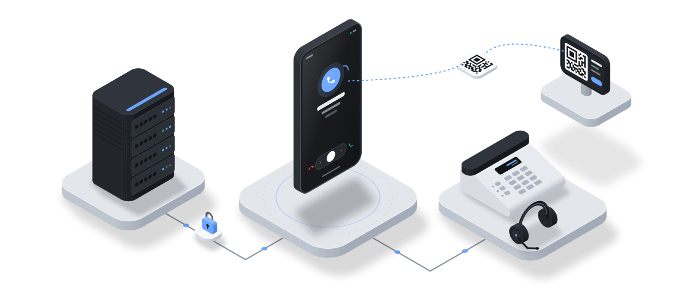
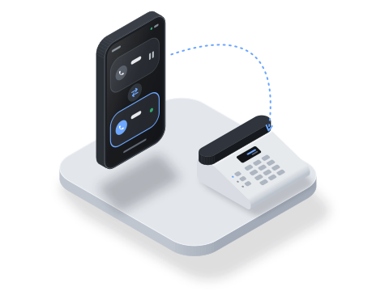
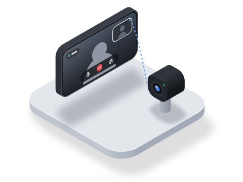
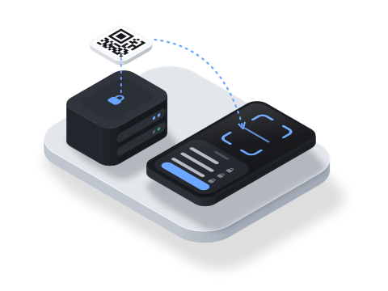
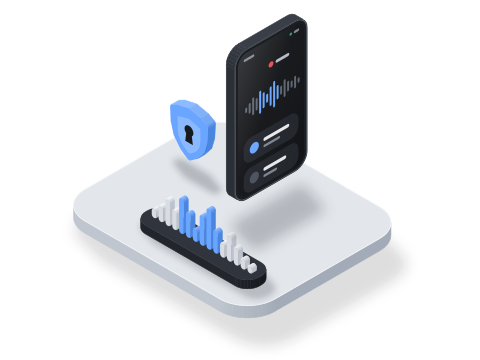

<a href="README.md">中文</a> | English

<h1 align="center">SipLink</h1>

Android SIP softphone for offices with an IP PBX

   

   

SipLink is a SIP softphone based on the [Linphone SDK](https://www.linphone.org/en/liblinphone-voip-sdk), with a user interface written in Jetpack Compose. It is mainly for voice calls, supports one-to-one video calls, and has no instant messaging.

This repository also contains the [management platform](docs/en/platform.md) (`platform/`): a server that provisions accounts, settings, directories and shortcut keys to many phones from one place, published as a Docker image.

    

<a href="docs/en/features.md#calls-and-call-features">Calls and call features</a> · <a href="docs/en/features.md#shortcut-keys">Shortcut keys</a> · <a href="docs/en/features.md#video-calls">Video calls</a> · <a href="docs/en/features.md#remote-configuration">Remote configuration</a> · <a href="docs/en/features.md#recording-and-security">Recording and security</a>

## Download

Download the APK from [GitHub Releases](https://github.com/tom231efa/siplink-android/releases) and install it. The app checks GitHub for new versions, which can be downloaded in the app and handed to the system installer.

- Android 9 or later
- The published APK is for 64-bit ARM (arm64-v8a) devices
- So far tested on Android 16 only

The update check contacts `api.github.com` and can be turned off in Settings, see [Privacy and permissions](docs/en/privacy.md).

## Documentation

- [Features](docs/en/features.md)
- [Screenshots](docs/en/screenshots.md)
- [User guide](docs/en/user-guide.md): accounts, calls, conference room, video, feature codes, shortcut keys, directories, recording, settings
- [Remote configuration](docs/en/remote-configuration.md): loading and sync, what is locked, configuration document format
- [Management platform](docs/en/platform.md): the server that provisions configuration, Docker deployment
- [FAQ](docs/en/faq.md): no incoming calls, no sound in calls, certificates, LDAP, updates
- [Privacy and permissions](docs/en/privacy.md): what each permission is for, what the app connects to, what is stored on the phone
- [Building](docs/en/build.md) and [testing](docs/en/testing.md)

## License

[GNU AGPL-3.0](LICENSE). This project uses the Linphone SDK, which is available under AGPLv3 or a commercial license.
