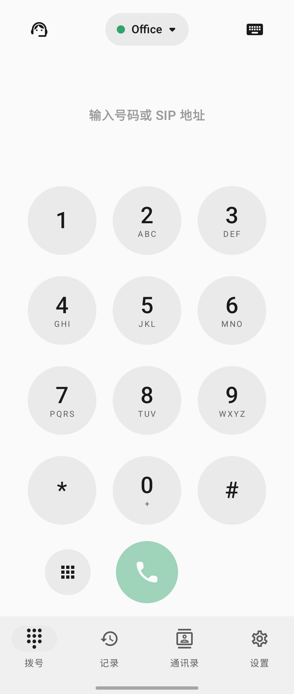
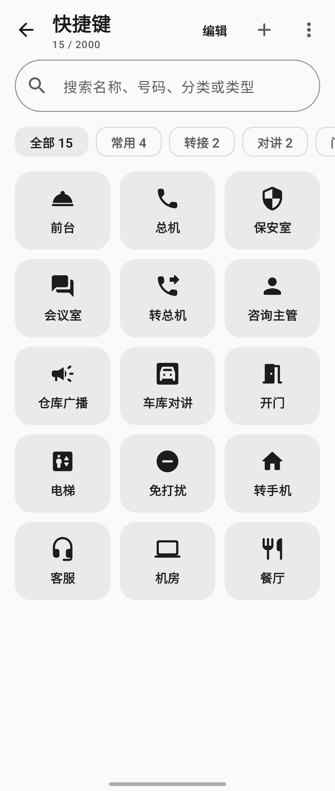
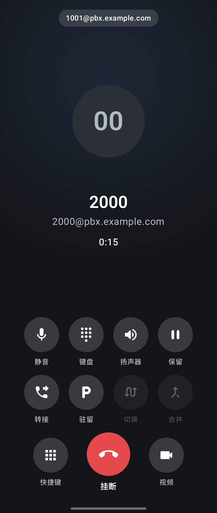
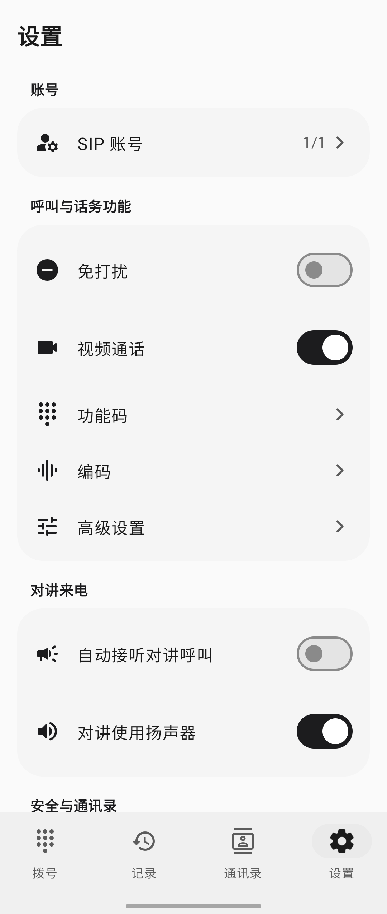

  

<h1 align="center">SipLink</h1>

面向 IP PBX 办公场景的 Android SIP 软电话

  
  
  
  

<table align="center">
  <tr>
    <td align="center"> 拨号</td>
    <td align="center"> 快捷键</td>
    <td align="center"> 通话</td>
    <td align="center"> 设置</td>
  </tr>
</table>

## 简介

SipLink 是基于 [Linphone SDK](https://www.linphone.org/en/liblinphone-voip-sdk) 的 SIP 软电话，界面使用 Jetpack Compose 编写。以语音通话为主，支持一对一视频通话，不含即时消息。

## 功能

| 类别 | 内容 |
| --- | --- |
| 线路 | 最多 100 个 SIP 账号；UDP / TCP / TLS，SRTP；每条线路可设代理、备用代理和 DNS 服务器；CSV 批量导入 |
| 通话 | 保留、盲转、咨询转、驻留、合并（三方通话）、呼叫等待、呼叫前转、免打扰、拒接匿名来电 |
| 话务功能 | 对讲及自动接听、监听 / 耳语 / 强插、强拆、指定代接、同组代接、语音信箱；功能码按 PBX 配置 |
| 视频 | 一对一视频通话，可关闭；清晰度 240p–1080p，帧率可选；支持横屏 |
| 快捷键 | 速拨、转接、发送按键、呼叫前转、免打扰；分类、图标、固定线路；CSV 导入导出 |
| 通讯录 | 最多 50 个 LDAP 通讯录，支持 StartTLS；来去电显示姓名；本地缓存 |
| 远程配置 | 扫描管理平台二维码载入配置并定期同步，下发内容在本机只读 |
| 其它 | 通话记录、编码选择、CA 证书管理、后台保持注册（不依赖推送）、深浅色主题 |

## 运行要求

- Android 9 及以上
- 发布的安装包面向 64 位 ARM（arm64-v8a）设备
- 目前仅在 Android 16 上测试过

## 获取

从 [GitHub Releases](https://github.com/tom231efa/siplink-android/releases) 下载 APK 并安装。应用会检查 GitHub 上的新版本并在设置中提示，安装包由浏览器下载。

更新检查会访问 `api.github.com`，可在设置中关闭，详见[隐私与权限](docs/privacy.md)。

## 文档

| 文档 | 内容 |
| --- | --- |
| [使用指南](docs/user-guide.md) | 账号、通话、视频、功能码、快捷键、通讯录、设置 |
| [远程配置](docs/remote-configuration.md) | 载入与同步、锁定范围、配置文档格式（供管理平台实现参考） |
| [隐私与权限](docs/privacy.md) | 权限用途、联网对象、本机存储内容 |
| [常见问题](docs/faq.md) | 收不到来电、通话无声、证书、LDAP、更新等 |
| [构建](docs/build.md) | 构建环境、调试包与发布包、签名、项目结构 |
| [测试](docs/testing.md) | 单元测试、Lint、集成测试环境 |

## 许可证

[GNU AGPL-3.0](LICENSE)。本项目使用 Linphone SDK，它以 AGPLv3 或商业许可提供。
