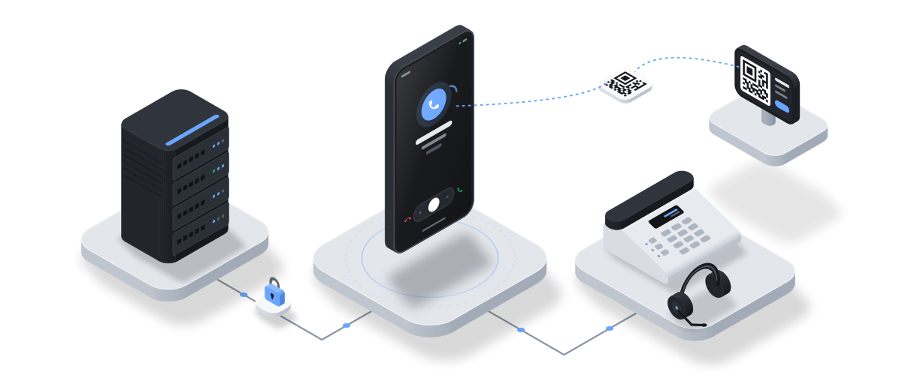
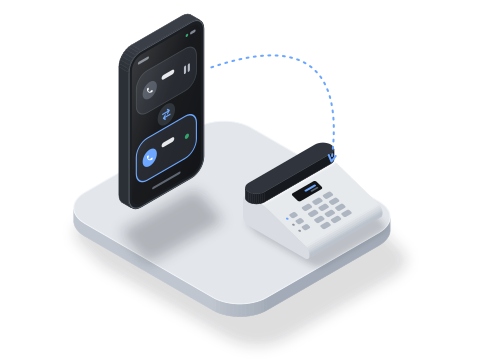
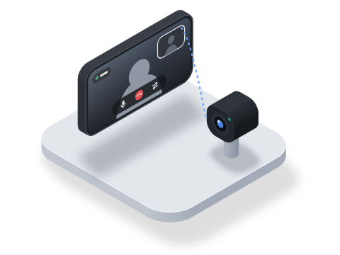
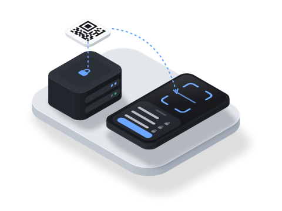

中文 | <a href="README.md">English</a>

<h1 align="center">SipLink</h1>

面向 IP PBX 办公场景的 Android SIP 软电话

   

   

SipLink 是基于 [Linphone SDK](https://www.linphone.org/en/liblinphone-voip-sdk) 的 SIP 软电话，界面使用 Jetpack Compose 编写。以语音通话为主，支持一对一视频通话，不含即时消息。

本仓库同时包含[管理平台](docs/zh-CN/platform.md)（`platform/`）：为多部手机集中下发账号、设置、通讯录和快捷键的服务端，以 Docker 镜像发布。

    

<a href="docs/zh-CN/features.md#通话与话务功能">通话与话务</a> · <a href="docs/zh-CN/features.md#快捷键">快捷键</a> · <a href="docs/zh-CN/features.md#视频通话">视频通话</a> · <a href="docs/zh-CN/features.md#远程配置">远程配置</a> · <a href="docs/zh-CN/features.md#录音与安全">录音与安全</a>

## 获取

从 [GitHub Releases](https://github.com/tom231efa/siplink-android/releases) 下载 APK 并安装。应用会检查 GitHub 上的新版本，可在应用内下载并交由系统安装。

- Android 9 及以上
- 发布的安装包面向 64 位 ARM（arm64-v8a）设备
- 目前仅在 Android 16 上测试过

更新检查会访问 `api.github.com`，可在设置中关闭，详见[隐私与权限](docs/zh-CN/privacy.md)。

## 文档

- [功能特性](docs/zh-CN/features.md)
- [应用截图](docs/zh-CN/screenshots.md)
- [使用指南](docs/zh-CN/user-guide.md)：账号、通话、会议室、视频、功能码、快捷键、通讯录、录音、设置
- [远程配置](docs/zh-CN/remote-configuration.md)：载入与同步、锁定范围、配置文档格式
- [管理平台](docs/zh-CN/platform.md)：集中下发配置的服务端，Docker 部署
- [常见问题](docs/zh-CN/faq.md)：收不到来电、通话无声、证书、LDAP、更新
- [隐私与权限](docs/zh-CN/privacy.md)：权限用途、联网对象、本机存储内容
- [构建](docs/zh-CN/build.md)与[测试](docs/zh-CN/testing.md)

## 许可证

[GNU AGPL-3.0](LICENSE)。本项目使用 Linphone SDK，它以 AGPLv3 或商业许可提供。
