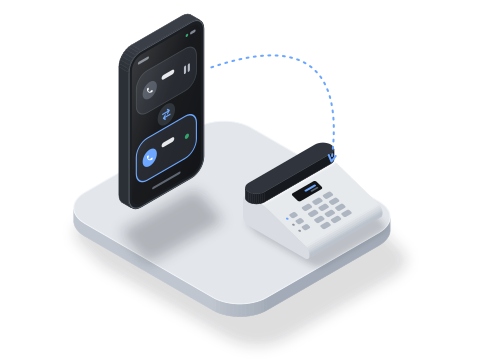
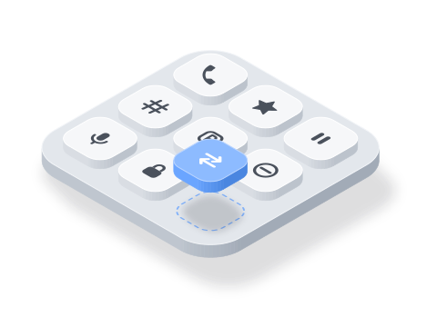
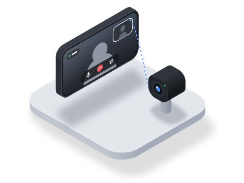
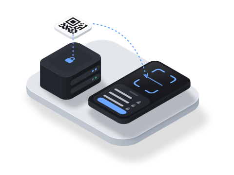
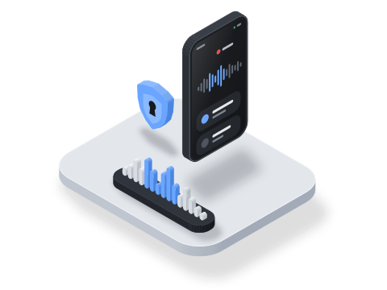

<a href="../features.md">中文</a> | English

# Features

[Home](../../README.en.md) · [Screenshots](screenshots.md) · [User guide](user-guide.md) · [Management platform](platform.md)

## Calls and call features

- Slide to answer or decline incoming calls; hold, mute, and switch between earpiece, speaker and Bluetooth during a call
- Blind transfer, attended transfer, park, merge into a three-way call
- Call waiting, call forwarding (always / when busy / on no answer), do not disturb, reject anonymous calls
- Intercom: optional auto answer on the speaker
- Auto answer for regular calls: immediately or after 3–30 seconds
- Listen / whisper / barge, force hang-up, directed pickup, group pickup, voicemail; feature codes set to match the PBX

 

## Lines

- Up to 100 SIP accounts; choose the outgoing line when dialing
- UDP / TCP / TLS, SRTP
- Proxy, backup proxy and DNS server per line
- Bulk import from CSV

## Shortcut keys

- Speed dial, transfer, send DTMF, call forwarding, do not disturb
- Categories, icons, a specific line per key
- Long-press and drag to reorder, search by name
- CSV import and export

 

## Video calls

- One-to-one video calls; can be turned off as a whole in Settings
- Sending resolution 240p–1080p, selectable frame rate
- The other party's video keeps its aspect ratio; switch between "Fit" and "Fill"
- Landscape supported; switch between front and back cameras, pause your own video

 

## Directories

- Up to 50 LDAP directories, with StartTLS
- Names from the directory shown for incoming and outgoing calls
- Local cache

## Remote configuration

- Load the configuration by scanning a QR code from the management platform or entering its address; it syncs regularly afterwards
- Accounts, directories, certificates, codecs, settings and shortcut keys are provisioned by the platform and read-only on the phone
- Do not disturb, appearance and call history stay with the user; up to 50 shortcut keys of the user's own can be added
- Provisioned passwords can be protected by a configuration password

The management platform is published as a Docker image with a web console (eight languages) and an LDAP directory service, see [Management platform](platform.md). For the configuration document format, see [Remote configuration](remote-configuration.md).

 

## Recording and security

- One-tap call recording, also in video calls (audio only); can record every call by default
- Recordings are saved as AAC (`.m4a`), filtered by time, played and exported; selectable number to keep, 2 GB in total at most
- TLS signaling and SRTP media encryption, with server certificate and hostname verification
- CA certificate management in the app; private CAs can be imported

 

## Other

- Call history
- Enabling and ordering audio and video codecs
- Stays registered in the background without a push service
- Dark and light themes, or follow the system
- Checks for, downloads and installs updates in the app
