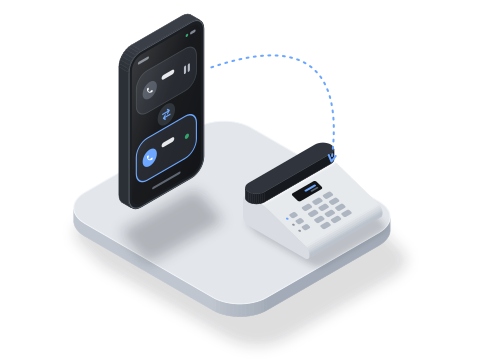
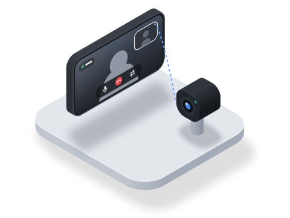
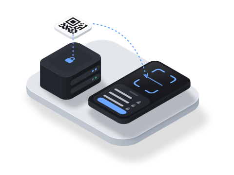
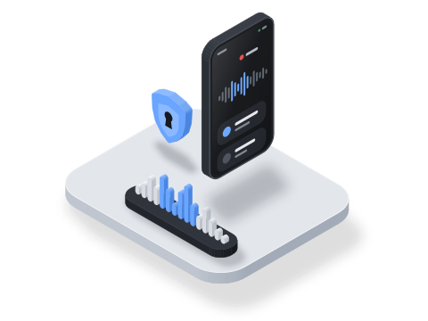

中文 | <a href="en/features.md">English</a>

# 功能特性

[返回首页](../README.md) · [应用截图](screenshots.md) · [使用指南](user-guide.md) · [管理平台](platform.md)

## 通话与话务功能

- 来电滑动接听或挂断；通话中保留、静音、切换听筒 / 扬声器 / 蓝牙
- 盲转、咨询转、驻留、合并为三方通话
- 呼叫等待、呼叫前转（无条件 / 遇忙 / 无应答）、免打扰、拒接匿名来电
- 对讲：可自动接听并使用扬声器
- 常规来电自动接听：立即或在 3–30 秒后接听
- 监听 / 耳语 / 强插、强拆、指定代接、同组代接、语音信箱；功能码按 PBX 配置

 

## 线路

- 最多 100 个 SIP 账号，拨号时可选择呼出线路
- UDP / TCP / TLS，SRTP
- 每条线路可设代理、备用代理和 DNS 服务器
- CSV 批量导入

## 快捷键

- 速拨、转接、发送按键、呼叫前转、免打扰
- 分类、图标、固定线路
- 长按拖动排序，按名称搜索
- CSV 导入导出

 

## 视频通话

- 一对一视频通话，可在设置中整体关闭
- 发送清晰度 240p–1080p，帧率可选
- 对方画面保持比例，可在“完整”和“铺满”之间切换
- 支持横屏；可切换前后摄像头、暂停本端画面

 

## 通讯录

- 最多 50 个 LDAP 通讯录，支持 StartTLS
- 来电和去电显示通讯录中的姓名
- 本地缓存

## 远程配置

- 扫描管理平台的二维码或输入地址载入配置，之后定期同步
- 账号、通讯录、证书、编码、设置和快捷键由平台下发，在本机只读
- 免打扰、外观和通话记录仍由用户自己设置；可另建最多 50 个快捷键
- 下发的密码可由查看口令保护

管理平台以 Docker 镜像发布，带网页控制台（八种语言）和 LDAP 通讯录服务，见[管理平台](platform.md)。配置文档格式见[远程配置](remote-configuration.md)。

 

## 录音与安全

- 通话中一键录音，视频通话同样可用（只录声音）；可设为默认录音
- 录音保存为 AAC（`.m4a`），按时间筛选、播放、导出；保留条数可选，总大小不超过 2 GB
- TLS 信令与 SRTP 媒体加密，可校验服务器证书和主机名
- 自带 CA 证书管理，可导入私有 CA

 

## 其它

- 通话记录
- 音视频编码的启用与优先级
- 后台保持注册，不依赖推送服务
- 深色与浅色主题，可跟随系统
- 应用内检查、下载并安装更新
