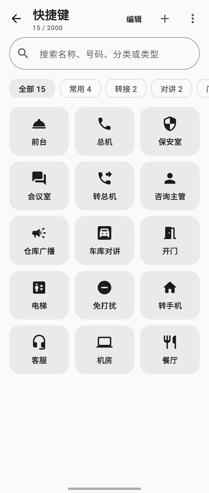
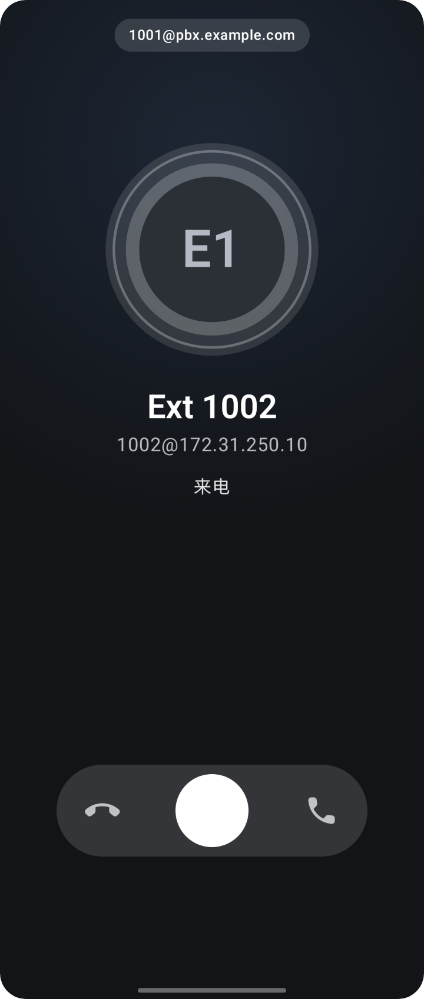
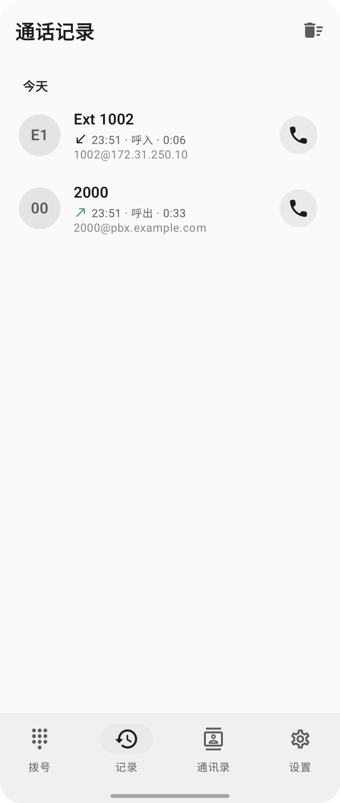
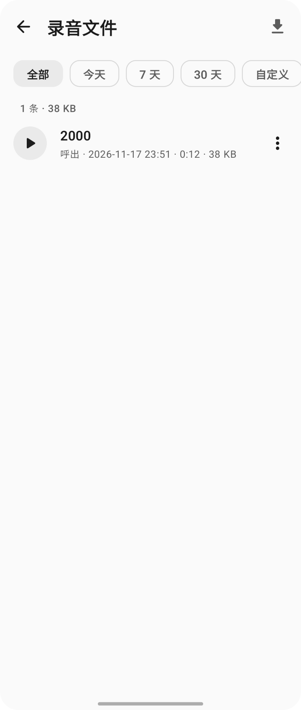
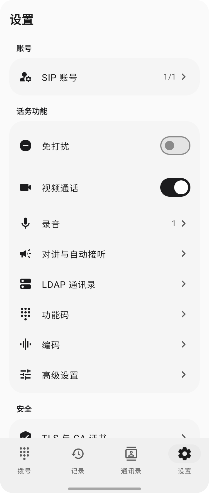
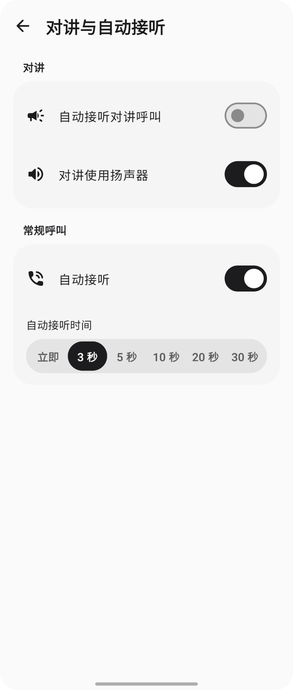

<a href="zh-CN/screenshots.md">中文</a> | English

# Screenshots

[Home](../README.md) · [Features](features.md) · [User guide](user-guide.md)

## Dialer and shortcut keys

 &nbsp; 

## Calls

 &nbsp; 

## Call history and recordings

 &nbsp; 

## Settings

 &nbsp;  &nbsp; 

